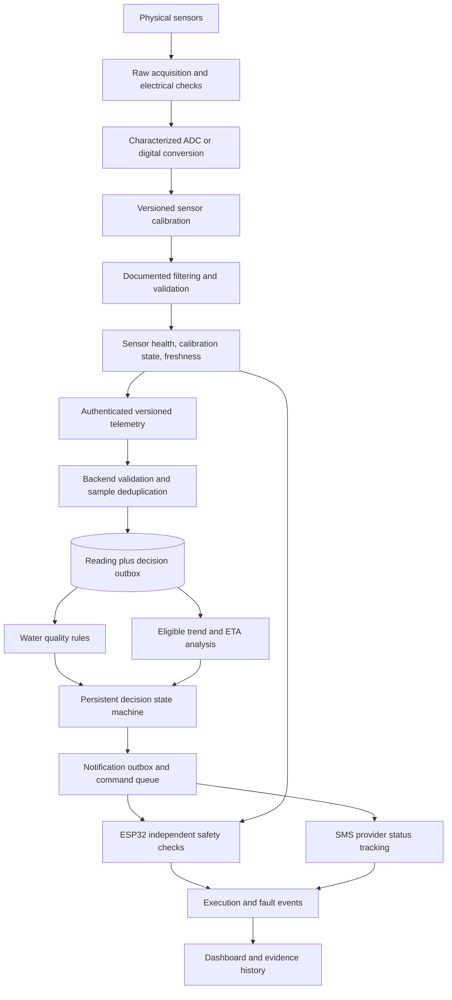

# AquaSense pre-calibration technical audit

Audit date: 15 September 2026. Source baseline: working tree at Git HEAD `ffc457bf`.

**Decision: NOT READY for final physical calibration or unattended water-quality automation. Overall pre-calibration readiness: 3/10.** Resolve the source conflicts, establish the electrical transfer functions, remove startup measurement bias, and connect quality/calibration gating before collecting final calibration coefficients.

This is a source and isolated-software audit, not a measurement-accuracy assessment. No application implementation was changed. No firmware was flashed, actuator operated, database contacted or migrated, or SMS sent. Only this report was added. Current sensor readings were not used to infer accuracy. The flashed firmware, actual wiring, resistor values, supply voltages, reference solutions and installed module revisions remain physically unverified.

The repository contains **15 files with unresolved merge conflicts**. Therefore, descriptions of conflicted backend/frontend paths below describe visible source branches and surrounding code, not a successfully running application. “Newer health branch” means the visible `Stashed changes` alternative; it is not an endorsement that choosing that side resolves all defects. Existing untracked `SMS_DELIVERY_DIAGNOSIS.md` and `docs/SENSOR_HEALTH_IMPLEMENTATION.md` were left untouched. The latter claims that firmware health validation replaced zero-seeded smoothing; the checked-in acquisition code contradicts that claim.

## 1. Current system readiness


Ratings measure engineering readiness in this checkout, not sensor accuracy. Higher scores recognize existing safeguards; they do not certify field operation.

| Area | Rating /10 | Reason |
|---|---:|---|
| Hardware/Firmware Architecture | 6 | Modular acquisition, networking workers, queue copies, bounded timers and relay interlocks are good foundations. Several incompatible firmware targets remain selectable, and physical configuration is unresolved. |
| Sensor Acquisition Logic | 3 | ADC1 pins and explicit 12-bit/11 dB setup in the integrated target are sensible. Voltage scaling is uncharacterized, ORP supply assumptions are suspect, and startup smoothing biases values. |
| Calibration Readiness | 2 | Named constants exist, but divider metadata, raw/voltage capture, profile identity, approved coefficients and a calibration lifecycle are missing from the live path. |
| Sensor Validation | 4 | Basic firmware range/rail checks and a useful backend validator exist. The richer firmware validator is unused; backend has rail, duplicate and legitimate-change handling weaknesses. |
| Data Quality Handling | 3 | Nulls, stale checks and diagnostic structures are partially present. Calibration-required data remains decision-eligible; bad required sensors suppress the entire telemetry frame. |
| Backend Reliability | 2 | Service separation and error handling exist, but package/source conflicts prevent a runnable baseline. Persistence and alert/SMS work are coupled. |
| Risk Engine | 3 | Rules are readable and parameter-specific. Thresholds conflict across modules, persistence/hysteresis are absent, and weighted aggregation can understate a severe single parameter. |
| Predictive Analytics | 3 | Timestamp-based regression and ETA calculations exist. Minimum history is advisory, confidence is heuristic, model dependencies do not match the installed sensor set, and provenance is incomplete. |
| Automation Safety | 4 | Integrated pumps are disabled by default; local timers, interlocks and some durable deduplication exist. Legacy feeding can repeat indefinitely after lost ACKs and hold open indefinitely; integrated stop/queue semantics also need work. |
| Database/Data Integrity | 3 | PostgreSQL models and useful indexes exist. No durable sample identity, calibration version or prediction input lineage; schema startup ordering and branch conflicts are blocking. |
| SMS Code Quality | 7 | Provider contract matches documentation; timeout ambiguity, reservations, cooldowns and status polling are considered. Recovery/fairness and integration gaps remain. Delivery is unverified. |
| Security | 3 | User auth, roles, CSRF and strict integrated actuator key checks are present. MQTT identity, plaintext defaults, WebSocket authentication and data ownership boundaries remain weak. |
| Fault Tolerance | 4 | Integrated local control survives network stalls and rejects stale snapshots. No offline history buffer, durable ingestion/decision retry or end-to-end physical feedback; legacy targets block on networking. |
| Overall Pre-Calibration Readiness | **3** | A promising modular foundation with blocking build, electrical-conversion, calibration-provenance and safety gaps. |

## 2. Critical problems and evidence

Severity: **CRITICAL** blocks safe operation or a reproducible baseline; **HIGH** can materially corrupt interpretation, data integrity, availability or control; **MEDIUM** affects reliability/maintainability; **LOW** is a limited presentation/documentation issue. Hardware-dependent findings are explicitly conditional.

| ID | Severity | Evidence and impact | Correction |
|---|---|---|---|
| A01 | CRITICAL | [Backend/package.json](../Backend/package.json), ingestion, MQTT, rules, prediction, schemas/models and four frontend files contain conflict markers. Backend npm fails `EJSONPARSE`; frontend type-check fails `TS1185`. | Resolve the merge deliberately, preserve nullable health semantics and ORP, then build and rerun tests. Do not calibrate against an unidentified executable. |
| A02 | HIGH | [sensorReadingService.ts](../Backend/src/services/sensorReadingService.ts) imports `waterHealthScore`, but [sensorValues.ts](../Backend/src/services/sensorValues.ts) does not export it. Existing tests still mock the older ingestion path and assert obsolete prediction text. | Repair interfaces and tests after conflict resolution; removing markers alone is insufficient. |
| A03 | HIGH | [SensorConversions.h](../Hardware/src/sensors/SensorConversions.h) uses `raw * 3.3 / 4095`. This is an assumed linear scale, not characterized ESP32 ADC voltage. | Calibrate electrical conversion for the exact board/channel/attenuation and preserve raw counts. |
| A04 | HIGH; physical damage risk conditional | The [reference sketch](../Hardware/reference/arduino-water-monitor/arduino-water-monitor.ino) identifies pH as PH-4502C **via a voltage divider**, but no resistor values or reconstruction factor appear in the integrated conversion. Analog module outputs and divider wiring are unverified. | Measure/document module and ADC-node voltage, divider orientation/resistances/tolerances, and safe input range before reference-solution calibration. |
| A05 | HIGH | ORP currently reduces to `1320 - Vadc_mV + offset`. Reference sketch names SEN0165; its documented 5 V circuit formula has a 2000 mV intercept. If that hardware matches, replacing the circuit supply term with 3.3 V introduces a **-680 mV intercept error**, separately from ADC/divider errors. | Separate module supply/circuit transfer from ADC conversion; verify actual module, supply, polarity and offset convention. |
| A06 | HIGH | [SensorManager.cpp](../Hardware/src/sensors/SensorManager.cpp), line 51, smooths temperature from zero. A valid first 25 °C sample becomes 7.5 °C. Turbidity and ORP are likewise biased. [compile_checks.cpp](../Hardware/test/compile_checks.cpp) explicitly asserts preservation of this behavior. | Initialize each filter from its first accepted sample; expose raw/unfiltered values and reset/warm-up status. Replace preservation tests with readiness requirements. |
| A07 | HIGH | [SensorHealth.h](../Hardware/src/sensors/SensorHealth.h) is included by isolated validation firmware, not by `SensorManager`. Main telemetry lacks its diagnostics, raw voltages, boot ID and sample ages. | Connect acquisition, diagnostic results and decision gates; verify the actual build target includes them. |
| A08 | HIGH | [MqttManager.cpp](../Hardware/src/communication/MqttManager.cpp), line 43, returns success without publishing when temperature, pH or turbidity fails; the worker then marks the sequence published. | Always publish bounded fault/health frames with per-sensor nulls; preserve healthy channels and heartbeat. |
| A09 | HIGH | [sensorHealth.ts](../Backend/src/services/sensorHealth.ts) always sets calibration `REQUIRED`, yet `valid=true` readings can trigger rules/SMS. Neither minimum collection period nor calibration approval is a prerequisite. | Separate technical validity from monitoring/control eligibility. Pre-calibration outputs should remain diagnostic/preliminary and operational decisions inhibited. |
| A10 | HIGH | Isolated execution reproduced a duplicate timestamp changing a previously `POSSIBLY_STUCK` sample to `VALID`; `stuckDurationMs` is recomputed only for fresh timestamps. A single 4095 rail sample also returns `VALID`. | Preserve prior health for duplicates; never accept a clipped sample as a measurement. Use persistence to classify the fault, not to legitimize saturated values. |
| A11 | HIGH | A six-sample pH window `[7,7,7,7,7,9]` becomes `UNSTABLE`, `valid=false`. The implementation cannot distinguish interference from a real rapid water change. | Mark plausibly real changes suspect, retain the evidence and emit a quality/environmental warning; confirm independently before control. Do not silently erase hazards. |
| A12 | HIGH | [sensorReadingService.ts](../Backend/src/services/sensorReadingService.ts), line 86, needs numeric `bootId` plus `sequence` for replay checks, but integrated firmware sends no `bootId`. Even detected replay is inserted again, and state is memory-only. | Durable unique `(device_id, boot_id, sequence)` or sample UUID; duplicates must not repeat storage/alerts or refresh acquisition time. |
| A13 | HIGH | Rule, predictive, in-memory and UI thresholds differ. Threshold PUT only changes an in-memory object, not the active rule/prediction constants. | One persisted, validated and versioned policy consumed by all decision/display paths. |
| A14 | HIGH | [waterAlertNotification.service.ts](../Backend/src/services/waterAlertNotification.service.ts) creates a new alert for every abnormal reading. Cooldown controls SMS frequency, not alarm transitions or false positives. | Per-device/parameter persistence, hysteresis, recovery and incident identity. |
| A15 | HIGH | [predictiveAnalytics.service.ts](../Backend/src/services/predictiveAnalytics.service.ts) requires measured DO and NTU turbidity. The specified hardware has ORP, no DO, and currently reports raw turbidity. | Return unavailable for this model; design explicitly scoped pH/temperature trend warnings without fabricating DO or silently renormalizing sensor coverage. |
| A16 | HIGH | Prediction proceeds with one eligible row; six samples only reduce confidence. Confidence is not a probability calibrated against outcomes. | Hard minimum count, span, freshness, continuity and regression fit gates; report insufficient data and separate data adequacy from predictive confidence. |
| A17 | CRITICAL if standalone feeder operates | [feeder/main.cpp](../Hardware/src/feeder/main.cpp) executes a pending command before ACK, has no durable command dedupe/expiry, and `ON` has no timeout. A lost ACK can dispense repeatedly; network loss can leave it open. | Disable/quarantine this target for operation or port the integrated safety behavior and test it. |
| A18 | HIGH | [hardwareService.ts](../Backend/src/services/hardwareService.ts) cancels pending work and creates stop commands without a transaction/lock. Concurrent starts can survive a stop. `AERATOR_OFF` and feeding OFF lack the same priority/cancellation behavior. | Serialize per-device queue mutations and define stop precedence, cancellation generation and idempotency. |
| A19 | HIGH | [DashboardWaterChangePage.tsx](../Frontend/src/pages/dashboard/DashboardWaterChangePage.tsx) defaults unavailable prediction to LOW/Stable, reports a local timer cycle as “completed,” and calls real `/sms/test` after an automatic simulation. | Explicit unavailable/demo state, no simulation-triggered production notifications, physical status only from device evidence. |
| A20 | HIGH | [waterQualityWS.ts](../Backend/src/websocket/waterQualityWS.ts) has no connection authentication/ownership filtering. HTTP water/alert/prediction queries are also globally scoped. | Authenticate sockets; authorize all data, alert actions and subscriptions by owner/device/tank. |
| A21 | HIGH | Main firmware defaults to public MQTT over port 1883 and HTTP device control. Scalar topics lack device identity; JSON `deviceId` is payload-controlled. | Private authenticated TLS broker, topic ACL/device binding and HTTPS device control with verified CA. |
| A22 | HIGH | [models/index.ts](../Backend/src/database/models/index.ts) executes ALTERs on required tables before `syncDatabase()` creates them. Reading persistence then waits for downstream notification work; a notification failure can return an ingestion error after the row was saved. | Ordered migrations on a test database; atomic reading/outbox commit, independent idempotent decision/notification processing. |

## 3. Fix before calibration

The minimum gate for collecting **final calibration coefficients** is A01–A08 plus stable configuration/provenance and raw logging. Safe bench acquisition and voltage characterization can precede final chemical calibration. Operational alerts/control must remain inhibited until the remaining safety gates pass.

1. Select the `water-monitor` target for the specified ORP hardware, or explicitly document another choice. Record board identity, source hash, build target and binary hash. Current default environments also build `water-quality`, `water-quality-legacy` and `feeder`; their safety/units differ.
2. Identify the actual pH, turbidity and ORP module revisions; measure supplies and divider values. The source comments are evidence of design intent, not proof of installed hardware.
3. Characterize each ADC channel against a trusted voltmeter across the intended input region. Distinguish ADC electrical calibration from probe calibration. Do not simply replace 3.3 with another universal constant.
4. Correct ORP module-supply separation and pH divider treatment; establish turbidity units/curve interface and monotonic direction.
5. Remove zero-seeded filtering; retain raw ADC, ADC-node voltage, reconstructed module voltage and unfiltered calibrated value during calibration capture.
6. Add sensor-specific stabilization, conversion-completion and reset behavior; preserve raw error sentinels before applying offsets/filtering.
7. Integrate per-sensor health and fault publication. Keep technical validity, chemical calibration status and decision eligibility separate.
8. Add durable calibration profiles, coefficient validation, version/hash and atomic persistence; factory defaults must never claim calibration completion.
9. Freeze units, timestamp semantics and sample identity before collecting historical evidence. Preserve old uncalibrated data as such.
10. Disable operational notifications and uncommissioned policies during bench/reference-solution work. A buffer-solution pH is not a tank emergency.

Do not tune thresholds to make uncalibrated values appear normal. Do not hide conversion errors inside a large calibration offset.

## 4. Calibration-ready checklist

| Sensor | Current implementation | Formula correct? | Code ready for calibration? | Missing preparation | Physical calibration required? |
|---|---|---|---|---|---|
| DS18B20 | GPIO4, DallasTemperature, 12-bit, async request + 750 ms wait, -127/range checks, offset then EMA | Digital conversion delegated to library; zero-seeded EMA distorts reported temperature | Partly | Bind ROM/device identity; confirm powered/parasite mode, pull-up and conversion completion; startup 85 °C handling; first-valid initialization; raw/reference logging; correction profile | **REQUIRES PHYSICAL CALIBRATION / reference verification**; apply an offset only if measured bias warrants it |
| pH | GPIO35 in integrated target; 10 ADC samples at 10 ms; integer mean; assumed voltage; `7+(2.5-V)/0.18` | Algebra consistent, but transfer/divider and coefficients unverified; cannot certify pH | No | ADC characterization; measured divider; slope/intercept at a declared voltage node; buffers/temperature metadata; fit residuals; approved range; profile persistence | **REQUIRES PHYSICAL CALIBRATION** |
| Turbidity | GPIO34; 10-sample integer mean and zero-seeded EMA; correctly tagged `raw_adc` in integrated MQTT | Raw counts are valid units for diagnostics; there is no NTU formula | No | Safe voltage conditioning; ADC/module volts; actual reference-sample curve/table; units, domain and out-of-domain handling; remove startup bias | **REQUIRES PHYSICAL CALIBRATION** |
| ORP | GPIO32; 10-sample mean; `1320-Vadc_mV+offset`, EMA; finite/nonrail checks | Not defensible for the referenced 5 V SEN0165 without correction/verification | No | Actual module/supply; ADC/divider transfer; signal inversion/gain; reference-electrode convention; correction sign; standard solution checks and stabilization; profile | **REQUIRES PHYSICAL CALIBRATION / standard-solution verification** |

No final sensor coefficients are proposed in this audit.

## 5. Backend audit

All paths below are under `Backend/src/` unless otherwise stated. Source conflicts remain the first blocker.

| Module/File | Current responsibility | Problem | Severity | Recommended correction | Reason |
|---|---|---|---|---|---|
| `services/sensorReadingService.ts` | Ingest, map, query and summarize readings | Conflicted duplicate implementations; missing `waterHealthScore`; replay inserted; timestamps default to receipt; latest globally selected by `createdAt` | CRITICAL/HIGH | One ingestion contract; durable identity; per-device queries; distinct acquisition/receipt times | Reproducibility and correct historical ordering |
| `services/sensorHealth.ts` | Numeric, physical, freshness, window and TAN validation | Duplicate stuck-health regression; early rail acceptance; fixed unit-insensitive turbidity noise threshold; no calibration approval path | HIGH | Immutable per-sample diagnostics; explicit quality flags, units, calibration state and eligibility | Avoid false-valid inputs and false-suppressed real changes |
| `middleware/validate.ts` | Zod request validation | Old coercion can turn null/boolean into numbers; newer passthrough lacks bounded typed diagnostic envelopes | HIGH | Preserve malformed readings as diagnostics while validating outer identity/version/time/types/size | Robust diagnostics do not require trusting arbitrary structure |
| `services/mqttService.ts` | MQTT parsing and scalar aggregation | Conflicts; unauthenticated claimed device identity; scalar streams can mix devices/cycles; no bounded processing queue; old branch calls a sanitizer with no visible definition | HIGH | Versioned per-device frame; ACL identity binding; bounded work queue and consistent parser | Reject spoofed/mixed frames and control backlog |
| `api/v1/controllers/sensorsController.ts`, `iot/water/controllers/waterController.ts` | HTTP ingestion | Store then await alerts/SMS; response can fail after storage; no durable retry identity | HIGH | Commit reading + decision outbox; return accepted sample ID; async workers | Avoid duplicates and lost decisions on retry/crash |
| `services/waterAlertNotification.service.ts`, `alert.service.ts` | Rules, alert records, SMS and prediction triggers | New alert each abnormal sample; no persistence/recovery state; downstream failure affects ingestion | HIGH | Incident state machine and durable decision jobs | Cooldown alone cannot prevent false alarms or alert-table growth |
| `services/ruleEngine.service.ts` | Current-value threshold alerts | Hardcoded policy; preliminary data eligible; no hysteresis; fallback constructs fresh validator each call | HIGH | Versioned policy, explicit required inputs, eligibility, severity/persistence | Stable, explainable decisions |
| `services/predictiveAnalytics.service.ts` | Weighted environmental score, trend, ETA | Incompatible sensor dependencies; insufficient-data gate too weak; arbitrary confidence; threshold discontinuities; cross-request global latest selection | HIGH | Explicit model scope; per-device immutable input window; minimum span/count and fit checks | Scientifically honest early warning |
| `iot/water/services/waterQualityService.ts` | In-memory thresholds, older scoring/storage | Threshold PUT affects this object only; shallow nested replacement; status marks ideal temperature/pH as warning; high temperature never critical in its alert branch | HIGH | Retire unused calculations after caller check; persist one validated policy | Avoid divergent interpretations; do not maintain a second risk engine |
| `database/models/SensorReading.ts` | Reading storage | Conflicts; no unique sample ID, calibration/firmware version, durable raw acquisition columns from actual firmware; no declared device FK | HIGH | Minimum provenance schema and identity/index constraints | Enables traceability and deduplication |
| `database/models/PredictionLog.ts`, `services/predictionLog.service.ts` | Historical risk results | No device/model/policy/calibration version, input IDs/window or confidence saved | HIGH | Save decision lineage and source window summary | A score alone cannot be reproduced for defense |
| `database/models/index.ts`, `database/connection.ts` | Startup schemas and database connection | ALTER-before-create; ad hoc nontransactional compatibility migrations; DB credentials/config duplicated; defaults include postgres password | HIGH | Ordered versioned migrations, strict central config, least-privileged runtime account | Predictable deployment and recovery |
| `services/hardwareService.ts`, `hardwareProtocol.ts` | Queued commands, sync, state | Stop/start races; only some stops prioritized; acknowledgement is not verified physical completion | HIGH | Transactional queue, command state lifecycle and stop semantics | Physical actions need stronger consistency than UI requests |
| `services/feedingService.ts`, feeding controller | Schedules and feeder commands | Schedules belong to user, not specific tank/device; old sync has no TTL; unlimited manual queue; swapped `scheduleCount`/`enabledCount` queries | HIGH/MEDIUM | Device-bound schedules, max schedules, expiry/dedup/cooldown; correct counters | Avoid multiple feeders dispensing the same owner's schedules |
| `websocket/waterQualityWS.ts` | Live readings/statistics/history | No socket auth/ownership; unbounded client window requests; several async handlers lack catches; HTTP writes do not immediately broadcast | HIGH | Authenticated device-scoped rooms; input bounds; shared post-commit event path | Prevent data exposure, load abuse and divergent UI updates |
| `services/sms*.ts`, `cooldown.service.ts` | Provider calls, formatting, logging, resend control | Mostly sound submission semantics; uncertain outcomes can permanently block category, polling can starve later rows | MEDIUM/HIGH | Explicit reconciliation state and operational recovery; fair bounded polling | Preserve duplicate safety without silently abandoning future alerts |
| `server.ts` | App lifecycle, limits, health | `/health` only proves process uptime; 500 requests/15 min/IP shared by device sync and dashboard; uncaught exceptions often continue | HIGH/MEDIUM | Separate liveness/readiness/dependency health, device/user limits and controlled crash/restart | One device at 5 s uses 180 requests/15 min; browsers and NAT peers can consume the remainder |

Database failures currently stop a new reading's storage path; MQTT catches/logs failures but has no durable retry. A committed row can survive while its alert/event fails. Status/reporting must distinguish accepted measurement, persisted event, submitted notification and physical completion.

## 6. Sensor processing and electrical audit

### Exact integrated processing paths

Source: [SensorManager.cpp](../Hardware/src/sensors/SensorManager.cpp), [SensorConversions.h](../Hardware/src/sensors/SensorConversions.h), [CalibrationConfig.h](../Hardware/include/config/CalibrationConfig.h), [DeviceConfig.h](../Hardware/include/config/DeviceConfig.h).

Let `r` be the integer-truncated ten-sample ADC mean and `V = r × 3.3 / 4095` volts. These describe current code, not approved calibration equations.

| Sensor | Actual path | Required changes |
|---|---|---|
| Temperature | Request conversion → wait 750 ms → first discovered DS18B20 → add offset → reject disconnected/nonfinite/outside -55..125 °C → `0.7 × previous + 0.3 × corrected` → boolean validity | Capture raw and ROM ID; conversion/power-up validity before offset; first-valid initialization; separate stabilization/calibration state |
| Turbidity | GPIO34 → ten `analogRead`s spaced ≥10 ms → integer average → reject only mean 0/4095 → EMA → `turbidityRaw` | Inspect individual rail hits/min/max/spread; calibrated ADC volts → module volts → measured reference curve; do not label counts NTU |
| pH | GPIO35 → same burst/average → `7 + (2.5 − V)/0.18` → reject mean rails and pH outside 0..14 → expose pH directly | Characterize ADC and divider, fit slope/intercept at declared node, stabilize and validate; no hardcoded unverified pH coefficients |
| ORP | GPIO32 → burst/average → `(30×3300 − 75×r×3300/4095)/75 + offset` → reject mean rails/nonfinite → EMA | Separate circuit-supply term from ADC volts; recover module voltage; verify gain/inversion and standard offset; initialize filter correctly |

`finishSample()` exposes a coherent completed frame and increments sequence even when a channel fails. Invalid channels retain previous numeric fields internally with `valid=false`; consumers must respect that flag. The integrated LCD does respect flags and a 15 s freshness limit. Serial debug still prints retained numbers with an invalid label.

One complete acquisition takes nominally at least `750 + 3×10×10 = 1050 ms`, followed by a 5000 ms idle pause: approximately **6.05 s between completed frames**, plus scheduling/library overhead. Individual channels have acquisition skew of several hundred milliseconds, but only one completion time is recorded. This is not exactly a 5 s sampling period.

For a constant signal and the current zero seed, after `n` accepted samples the EMA is `signal × (1 − 0.7^n)`. At sample 10, residual startup bias is about 2.82%. The automation `sequence >= 10` gate counts completed frames, not consecutive healthy/calibrated samples, and does not protect backend alerts from the first biased reading.

### ADC and module transfer correctness

GPIO32, 34 and 35 are ADC1 pins on the classic ESP32; the older GPIO36 input is also ADC1. That avoids ADC2/Wi-Fi contention. ADC resolution, attenuation, ADC characterization and safe voltage limits are different concepts. Espressif documents raw `analogRead` as uncalibrated and millivolt conversion as calibrated; its ESP32 documentation also describes reference-voltage variation and nonlinear accuracy limitations. Verify the version bundled with pinned `espressif32@6.10.0`, the exact board and measured voltage region before choosing the conversion API. Do not regard 4095 as a guaranteed 3.300 V measurement. [Espressif ADC API](https://docs.espressif.com/projects/arduino-esp32/en/latest/api/adc.html), [ESP-IDF 4.4 ADC characterization](https://docs.espressif.com/projects/esp-idf/en/v4.4/esp32/api-reference/peripherals/adc.html).

Use an electrical chain with named nodes: `Vadc = characterized ADC conversion(raw)`; for a passive divider with top resistor between module and ADC node and bottom resistor between node and ground, `Vmodule = Vadc × (Rtop + Rbottom) / Rbottom`. Actual resistor values, tolerance and input loading **REQUIRE PHYSICAL MEASUREMENT**. No values are supplied by the source. A gain/intercept calibrated directly at the ADC node can incorporate a fixed divider, but that node and hardware must be explicitly frozen; otherwise later adding divider compensation can apply it twice.

The named SEN0165 is specified for 5.00 V supply. Its example simplifies to `0.4 × supply_mV − output_mV − vendorOffset`, using the example's common supply/ADC reference. AquaSense's port changes both terms to 3300 and uses **plus** offset. Plus correction is acceptable if consistently defined as `reference − indicated`; it is not interchangeable with the vendor's subtraction convention. Conditional on the named 5 V circuit, expected nominal transfer is `2000 − Vmodule_mV`, while current transfer is `1320 − Vadc_mV`. Characterize first; do not enter +680 as a guessed calibration fix. [DFRobot SEN0165 specification](https://wiki.dfrobot.com/sen0165/), [manufacturer example](https://wiki.dfrobot.com/sen0165/docs/20099).

The turbidity model is not identified precisely enough to approve any datasheet curve. If it is SEN0189, the manufacturer specifies a 0–4.5 V analog output and says output decreases as turbidity increases. That would make an unconditioned ESP32 connection inappropriate and contradict an assumed “raw ADC high = dirty” automation direction. This is a conditional comparison, not identification of the installed module. [SEN0189 specification](https://wiki.dfrobot.com/sen0189), [analog response description](https://wiki.dfrobot.com/sen0189/docs/18001). Do not equate NTU with mg/L suspended solids or import generic polynomial coefficients.

DS18B20's 12-bit conversion can take 750 ms and its power-up temperature register is 85 °C. The code's async wait is structurally reasonable, but does not explicitly prove fresh conversion success or reject a power-up result. Treat 85 °C as suspect in reset/no-completion context, not an unconditional invalid temperature. Verify power mode, pull-up, wiring, ROM identity and library CRC/error behavior. [DS18B20 datasheet](https://www.analog.com/media/en/technical-documentation/data-sheets/ds18b20.pdf).

### Earlier firmware targets

| Target | Differences and risks |
|---|---|
| `water-quality` | GPIO4 temperature, GPIO34 pH, GPIO35 labeled DO, GPIO36 turbidity. pH is `3.5V−2`, clamped 0..14. “DO” is `15V/3.3`, clamped 0..20. Turbidity is zero above 2.5 V, otherwise `(2.5−V)×60`, clamped 0..150. These example relationships are unsupported for the user's sensor set. No actual ORP path. Never connect ORP and call this output DO. |
| `water-quality` timing/failures | Reads sensors once for logging and again for publication; logged/published values need not be the same sample. Temperature disconnect becomes plausible 0 °C. Turbidity uses 15 samples with 30 ms blocking delays; high-rail voltage becomes “clean” zero NTU. ADC setup relies on defaults. Wi-Fi reconnect is attempted repeatedly in the main loop; restart topic accepts any payload. |
| `water-quality-legacy` | GPIO35 pH, GPIO34 raw turbidity, GPIO4 temperature; no ORP. Ten-sample mean, same estimated pH, zero-seeded EMA. DS18B20 -127 is filtered directly. Blocking Wi-Fi/MQTT loops stop acquisition when communication fails. Separate scalar MQTT topics have no coherent sample ID/device identity. |
| `reference/arduino-water-monitor` | Preserved source outside production build filters; useful for tracing assumptions, not an approved executable. Blocking networking and old conversions remain. |
| `validation` | Sensor-health test firmware source exists, but no PlatformIO environment selects it. Its presence is not evidence that tests were built or run. |

### Filtering, diagnostics and hardware preparation

Use a simple starting policy for bench characterization: one coherent frame about every 5–6 s; retain a short analog burst of roughly 10–11 samples at 10–20 ms spacing; record burst minimum, maximum, spread and clipping. Reject physically impossible/clipped individual conversions before aggregation. Compare a median or lightly trimmed mean against the existing average under relay/pump noise. Choose one burst filter from those results; do not stack several filters automatically.

Use approximately six consecutive fresh observations for an initial stability indication and a 20-frame diagnostic window as a starting point, not proof of accuracy. Temperature, pH, ORP and turbidity need unit-specific limits and different stabilization times. Retain fast diagnostics independently from any slow display EMA. A post-calibration nonlinear turbidity curve and burst aggregation order must be documented because applying a nonlinear curve before averaging can differ from applying it afterward. Preserve the chosen algorithm/version during calibration and validation.

Check disconnect, rail saturation, excessive noise, implausible rate of change, frozen values, missing inputs, stale ages and sensor resets independently. A floating analog pin need not reach a rail; a plausible midscale value cannot prove probe presence. Nearly unchanged temperature can reflect DS18B20 quantization and genuinely stable water. These conditions generally justify `SUSPECT`/inspection before declaring physical failure.

Electrical acceptance must document safe ADC-node voltage under normal, disconnected and startup conditions; sensor module supply stability; common-ground paths or intentional isolation; high-current return routing; servo/pump supply transients; decoupling and inductive suppression; cable shielding/placement; analog settling; and any LCD/RTC I2C pull-ups to 5 V. Compare sensor signals with loads off/on and with pH/ORP probes individually/together immersed to reveal ground-loop interference. Actual violations are unverified; no full hardware redesign is proposed. Relay/flow/level feedback is absent and software timing cannot prove flow or prevent a welded relay.

## 7. Risk and prediction audit

### What the source calculates

`ruleEngine()` performs **current threshold detection**. It emits per-parameter severity/action suggestions, not a mortality probability. ORP is not a rule input. Ammonia toxicity rules are explicitly disabled in the newer code. Actions such as `WATER_REPLACEMENT` are recommendations in alert data; the reviewed backend notification path does not itself call `hardwareService.queue()` to execute them.

The predictive module combines current-value scoring, a five-sample moving average, least-squares trend detection and linear ETA-to-threshold extrapolation. It is a deterministic heuristic early-warning model, not machine learning, validated mortality forecasting or a separate statistical anomaly detector.

Its score uses DO weight 0.34, temperature 0.18, pH 0.14, turbidity 0.10 and ammonia 0. The code normalizes their sum, 0.76, yielding effective weights approximately 44.74%, 23.68%, 18.42% and 13.16%. For each parameter it blends 60% latest severity score and 40% five-sample average severity score, then adds directional trend penalties, capped in total by the final 0..100 clamp. Labels are LOW below 25, MODERATE below 50, HIGH below 75, otherwise CRITICAL.

These weights and cutoffs have no supplied outcome-based validation. The minimum score is nonzero even for ideal values. A single extreme temperature scoring 100 with other parameter scores 5 and no trend produces only `(100×.18 + 5×(.34+.14+.10))/.76 = 27.5`, MODERATE. A sudden extreme current value can be diluted further by the 60/40 blend. Keep any independently confirmed critical parameter visible and do not let the aggregate downgrade it.

Piecewise functions have jumps: `scoreAbove` changes from 5 to about 20 just above ideal; just above critical it becomes 85; it remains 85 up to emergency and jumps to 100 above it. Noise near boundaries can move labels abruptly. Threshold boundaries also differ across modules:

| Example | Rule alerts | Prediction scoring | In-memory/UI |
|---|---|---|---|
| Temperature 31 °C | WARNING (`>29`) | Already above ideal 30 | Overview calls 24..32 normal; in-memory warning is `>30` |
| pH 8.6 | CRITICAL (`>8.5`) | Between ideal 8.5 and warning 8.8 | Overview only Warning; other path uses its own thresholds |
| Turbidity 60 NTU | No alert until `>70` | Above ideal 50 | In-memory warning `>50`; overview High from 25 |

`waterQualityService.evaluateStatus()` also includes ideal temperature and ideal pH in its warning predicates. This old calculation is not the main database-backed ingestion path, but must not be reintroduced. Threshold GET/PUT currently uses this separate service, so apparent threshold edits do not alter the live rule constants.

### Scientific interpretation

Use **Water Quality Risk Score (heuristic)** or **Estimated Environmental Risk**, with coverage and data quality adjacent. No mortality probability, survival percentage or species-specific safe-water certification is justified by this code. Crayfish species, life stage, density, local husbandry policy and independent biological outcomes are not encoded. Formal thresholds need a documented husbandry source and review; no replacement farming thresholds are invented here.

**ORP is oxidation-reduction potential in mV, not DO in mg/L.** A redox electrode responds to electroactive species and reference-electrode conditions; several redox systems and interferences affect interpretation. Do not label native ORP as standard-hydrogen-electrode Eh without the appropriate reference correction. Initially show ORP as an independent observation/trend; only add a transparent environmental indicator after site validation. It cannot supply missing DO to the current model. [USGS redox electrode method and limitations](https://pubs.usgs.gov/publication/twri09A6.5).

The newer ammonia calculation is structurally defensible for its stated freshwater domain:

```text
pKa = 0.09018 + 2729.92 / (273.2 + temperature_C)
NH3 fraction = 1 / (1 + 10^(pKa − pH))
NH3 percent of TAN = 100 × fraction
NH3-N [mg/L as N] = TAN [mg/L as N] × fraction
```

pH and temperature alone determine the modeled **fraction**, not actual ammonia concentration. At 25 °C and pH 8 the code gives about 5.3842%; only if TAN is independently measured as 1 mg/L as N does calculated NH3-N become about 0.053842 mg/L as N. The code requires TAN units, source, validation flag and a recent timestamp and rejects saline mode. TAN's allowable age is a policy requiring contextual review, not a universal one-hour scientific guarantee. Inputs must represent the same water/time. These are calculated values, not direct NH3 measurements. [EPA ammonia speciation equations](https://nepis.epa.gov/Exe/ZyPURL.cgi?Dockey=P1005JLO.TXT).

The `273.2` term follows the cited equation; it is not automatically a bug to replace with 273.15. The freshwater/domain/uncertainty assumptions matter more. `hasMeasuredAmmonia` in prediction currently infers “measured” merely from a finite nonnull calculated NH3-N, and the UI says “Actual NH3-N.” Prefer **Calculated NH3-N from measured TAN**. Never relabel an old zero/default ammonia column as a measured zero.

### Prediction weaknesses and required behavior

- Enforce a real minimum count **and time span**, not only a confidence penalty. One observation cannot establish a trend; repeated timestamps cannot add evidence.
- Select one device/tank, one compatible calibration/policy version and a continuous time window. Do not regress across outages, maintenance, sensor replacements or unrelated devices.
- Preserve invalid/missing episodes and sample coverage. Rejecting all rapid changes as noisy can preferentially remove the very hazards being predicted.
- Fit residuals, direction persistence and a bounded forecast horizon are absent. `horizonMinutes` mainly selects lookback; ETA is not bounded to that horizon. Low-temperature ETA is omitted.
- Already unsafe conditions yield nonpositive ETA and currently become null. Report **already beyond threshold**, separately from unknown ETA.
- A fixed heuristic confidence up to 95 is not a measured chance of being correct. Replace with data adequacy/fit descriptors until independent backtesting supports probabilistic language.
- Current model correctly refuses absent DO/raw turbidity in its newer branch. With the specified four sensors this model remains unavailable **even after calibration**, unless its dependency design is changed or a real DO sensor is added. Do not manufacture DO to enable it.
- Preserve simple pH/temperature trend warnings with explicit limited coverage if useful; validate them with synthetic trajectories and held-out recorded time series before live alerts.

## 8. Automation safety and failure scenarios

### Existing integrated safeguards

[RelayController](../Hardware/src/actuators/RelayController.cpp) requires verified distinct GPIO25/26/27 assignments and active polarity, sets OFF before output mode and interlocks fill/drain. Current pin assignments/polarity are `-1`, so relays do not initialize. [ActuatorConfig](../Hardware/include/config/ActuatorConfig.h) leaves pump limits zero and water/aerator policies false. These are appropriate commissioning gates, not completed commissioning.

[WaterManager](../Hardware/src/controllers/WaterManager.cpp) bounds requested phase time below a hard limit of at most five minutes, supports manual override, cooldown for automatic cycles and a fault latch. [AeratorManager](../Hardware/src/controllers/AeratorManager.cpp) has on/off temperature hysteresis and, when automatic mode has been commissioned, turns aeration on for invalid/stale temperature. [FeedingManager](../Hardware/src/actuators/FeedingManager.cpp) uses elapsed-time servo phases, limits manual open hold to ten seconds, stores schedules/fired records in NVS before movement and inhibits scheduling without valid time. [SystemController](../Hardware/src/controllers/SystemController.cpp) checks command TTL and persists the last command ID before non-stop actions. Network workers keep synchronous TCP/HTTP out of the main control loop.

### Missing or incomplete safeguards

| Risk | Current behavior | Required correction/evidence |
|---|---|---|
| Untrusted auto input | Water starts after total sequence count ≥10 on a single threshold crossing; uses basic validity and raw turbidity thresholds | Calibrated, eligible per-sensor data; consecutive/persistent abnormal condition; commissioned direction/units; recovery hysteresis |
| Excessive repeated exchange | No per-hour/day cumulative volume/runtime budget; persistent abnormality can repeat after cooldown | Bound cycle count/volume budget and require recovery/operator review; validate replacement-water suitability |
| Flow/level failure | Time-only drain/refill, no float switches, flow sensing or relay feedback | Document supervised time-only limits; measure flow under adverse conditions and provide independently effective cutoff/protection as warranted |
| Sensor failure during pumping | Active phase checks relay state/timer, not newly lost sensor validity | Explicit per-phase fail behavior; never blindly stop draining/filling without considering remaining water; verify policy on a bench |
| Processor stall/reset | Main-loop timers cannot turn off a load if execution halts; reset returns OFF commands but physical contacts unknown | Watchdog supervision, safe electrical reset defaults, external protection where required; verify brownouts and startup glitches |
| Relay break-before-make | Outputs are written OFF then ON immediately | Verify contact release/operate times; add measured dead time if simultaneous physical conduction is possible |
| Emergency stop semantics | ALL_OFF disables water automatic mode and closes feeder now, but does not disable stored feeding schedules; schedules may run in a later minute | Define latched stop versus immediate stop; explicitly inhibit scheduled restart until resumed if presented as emergency stop |
| Command retry/reorder | Only last ID stored; retries after intervening commands are not a general replay ledger | Per-device monotonic command generation or bounded durable executed-ID ledger with retained result |
| Queue conflicts | Stop cancels and create are not atomic; stop can race with in-flight command or another queue writer | Transaction/lock, stop generation and explicit priority; test concurrent starts/stops and pending receipt cancellation |
| Feeder repetition | Multiple schedule IDs at same minute can feed sequentially; manual cycles have no feed-budget cooldown; same user schedules delivered to multiple devices | Device/tank schedule ownership, duplicate-time validation and minimum feed interval/dose budget |
| Acceptance versus completion | Receipt `accepted` sent at start; no cycle-completion/failure event linked to command; `ACKED` can include a rejected/busy result | Distinct accepted/running/completed/rejected/failed states and physical-feedback disclosure |
| Aeration policy | Manual ON indefinite; automatic policy based only on temperature, not measured oxygen | Explicit lifecycle/power/failure policy; continuous aeration may be intentional, so do not impose an arbitrary pump-like timeout |
| Local UI control | Water/aerator dashboard state is localStorage/timers, not hardware API state | Label demonstrations and show last device report age; do not claim physical operation |

On loss of Wi-Fi/backend, integrated acquisition and local hard deadlines should continue. Prevent new water exchange without approved fresh local measurements; allow only a commissioned local policy. Existing timed work must follow its bounded per-phase safety policy. Aeration and cached feeding may continue only under explicitly reviewed rules, valid clock and persistent dose limits. Do not let network availability itself imply healthy water. A blanket “all outputs OFF” is not universally the safest aquaculture policy.

| Failure scenario | Visible source behavior | Can it falsely appear healthy? / Required behavior |
|---|---|---|
| pH disconnect | Rails/impossible pH detected in integrated path; a floating plausible ADC can pass; required-channel failure suppresses MQTT frame | Yes until age expires, or indefinitely for plausible floating input. Publish error frame and sensor-presence uncertainty. |
| Turbidity disconnect | Only averaged rails checked in main firmware; older four-sensor target can map high rail to clean zero | Yes. Detect clipping at sample level; never clamp failure into clean water. |
| ORP disconnect | Integrated nonrail finite values pass; detected error sends ORP null while other values continue | Plausible floating values remain possible. Preserve diagnostics and independent freshness. |
| Temperature failure | Integrated rejects -127 but drops required frame; legacy filters -127 or substitutes zero | Yes in legacy. Preserve raw error state and publish healthy other sensors. |
| Sensor frozen | Main firmware has no stuck detector; backend window exists only in newer branch and has duplicate regression | Yes. Persistent health state; distinguish quantized stability from fault. |
| ADC zero/full-scale | Main mean rails rejected; burst clipping can average into plausible mean; backend accepts first rail | Yes. Clip counts and invalid sample eligibility immediately. |
| Wi-Fi loss | Main keeps sampling/controlling; legacy networking blocks sensor/schedule loop | Main telemetry ages out; backend/browser connectivity alone is not health. |
| MQTT loss | Main worker retries with latest-only queue and stale check; no historical backlog | Lost history, not recovered samples. Backend sets connected false on `disconnect` but not explicitly `close`/`offline`, so some failures may leave stale connection status. |
| Backend restart | Memory health/replay windows, threshold edits and in-flight process state reset; NVS controls remain | May appear freshly healthy without history. Persist identity/policy and publish restart/collecting states. |
| Database unavailable | New ingestion fails; no durable MQTT retry; post-save downstream failure may leave partial processing | `/health` still reports healthy after runtime DB loss. Expose readiness and durable pending work. |
| Malformed MQTT | JSON/parser failures caught; newer branch stores per-sensor diagnostics for malformed fields; arbitrary nested structures unbounded at MQTT layer | Require versioned envelope, bounds and rate limits; reject retained/replayed data consistently. |
| Stale dashboard | New display helper ages measurements at 15 s; some pages fall back to old statistics or LOW risk | Yes: water-change page defaults to Stable; aerator falls back to stats and treats zero DO as missing. |
| ESP32 restart | Integrated relays disabled/off, feeder closed, NVS last ID/schedules restored; filter values restart at zero | Reset provenance/boot ID missing; feeding schedule may legitimately resume unless latched stop exists. |
| Relay/servo fails physically | Software reports commanded GPIO/servo state only | Yes. “Commanded ON” is not measured flow/open position; report uncertainty/fault feedback. |
| SMS API fails | Rejected/unavailable/unknown states and cooldowns; ambiguous submission blocks resends | Correctly avoids claiming delivery, but future category alerts may remain blocked without reconciliation. |

## 9. SMS code review — no live test

**CODE APPEARS CORRECT for the core provider request/response contract. ACTUAL DELIVERY VERIFIED: NO.** The whole integration cannot run successfully in the conflicted checkout, and no provider account/status API was called during this audit.

[sms.service.ts](../Backend/src/services/sms.service.ts) uses HTTPS `POST /api/sms`, JSON `recipient`, `content`, `sender_id`, and Basic auth with secret key as username and empty password. It reads `message.status`, `reference_id`, `fail_reason`, and uses `GET /sms/:reference_id` for status. These match current UniSMS documentation, including `pending`, `retrying`, `sent`, `failed`. “Sent” is treated as provider status, not a handset receipt. Its E.164 requirement is consistent with the documented API contract. [UniSMS SMS documentation](https://unismsapi.com/docs/sms).

Correct or useful code:

- Ten-second HTTP timeout; empty/overlength/invalid-recipient checks; sender/key presence checks; placeholder key rejection.
- Retries only DNS/refused-connection cases known to precede submission, at most three attempts. Timeout/reset/5xx ambiguity is not blindly resubmitted.
- In-process lock plus PostgreSQL advisory transaction lock; reservation committed before provider submission; pending/unknown blocks duplicate sends.
- Standard 15-minute and emergency 5-minute SMS cooldowns, escalation handling, one-minute failure backoff and a circuit breaker.
- Combined rule messages and status logs; no API key echoed in normal provider logs; masking and mocked tests exist.

Problems and improvements:

1. `smsLogService.reconcilePending()` only selects pending/retrying rows. Unknown results with a known reference ID are not reconciled. A crash after reservation or provider acceptance can leave an unknown record that indefinitely blocks the device/category, including later emergencies. Provide a documented review/reconciliation workflow; never automatically resend an ambiguous submission without establishing its outcome.
2. Polling takes the oldest 20 pending rows. Failed lookups leave their `updatedAt` unchanged, so they can starve newer rows. Twenty ten-second timeouts can occupy about 200 seconds. Track `nextCheckAt`/attempts and use fair bounded scheduling; the in-process reconciling guard prevents overlap but not starvation.
3. SMS success and linked-alert `smsSentAt` updates are not in one transaction. A partial DB failure can leave the two views inconsistent. The reservation remains a good duplicate defense, but outcome/event updates need recoverable atomicity.
4. Rate-limit responses are treated as rejection; no provider Retry-After scheduling is implemented. Add provider-specific handling only from the applicable endpoint contract, with no blind retry of ambiguous submissions.
5. Permanent 4xx problems can be retried by a later automatic alert after one minute. Latch configuration/account failures until corrected and expose a service-health issue.
6. Template generation hardcodes 160 while configuration can allow less; validation can reject its own generated message. A 160-character limit is a local conservative policy, not the provider's documented 670-character maximum. Preserve units, location and “preliminary” context when shortening; generic fallback can lose the calibration caveat. Character length alone is not SMS encoding/segment accounting.
7. `sentAt` is initialized at reservation time, not actual provider-sent time. Rename/separate submitted/reserved/provider-status timestamps.
8. Frontend simulation invokes real `/sms/test`; separate demo, test and production notification events. Different categories can still notify the same recipient for one incident.
9. `FARMER_PHONE` is a global server setting; editing browser profile contact details does not change it. Cooldown identity is device/category, not recipient/incident. Review ownership and recipient mapping before multi-farm use.
10. `Backend/.env` is absent in the audited filesystem. Environment injection may still provide configuration, but credentials/sender/recipient readiness is **unverified**. Config requires an SMS key even when SMS is unused, so missing SMS config can block all backend startup. No secret values were printed.

Provider/account limitations are separate: valid credentials, account credit, approved/assigned sender, carrier acceptance, recipient correctness/availability and provider outages. UniSMS describes an assigned test sender and custom sender eligibility; do not assume an arbitrary project name is approved. [UniSMS sender information](https://unismsapi.com/). None of these conditions was tested here, and no single live-delivery root cause can be established from code alone.

## 10. Security audit

| Severity | Finding | Correction |
|---|---|---|
| CRITICAL, conditional deployment escalation | Plaintext authenticated device HTTP allows on-path theft/tampering of actuator credentials/commands if the configured network is exposed to an attacker | Verified HTTPS and protected device network before live controls; rotate credentials if exposure is established |
| HIGH | Public plaintext MQTT default; no backend binding of publisher to device identity; scalar topic mixing; older water target executes restart from any message on its subscribed topic | Private TLS broker, unique client IDs, per-device credentials/topic ACL, disable legacy unauthenticated command subscriptions |
| HIGH | Socket.IO lacks auth/ownership; client can request global readings/history/alerts outside HTTP auth | Authenticate handshake, owner/device rooms and bounded/rate-limited event schemas |
| HIGH | Alert reads/ack/resolve/resend and water/prediction histories lack owner scoping; role check alone permits cross-user access | Authorize resource ownership in every service query and mutation |
| HIGH | Development sensor auth bypass for missing keys; forged data can cause alerts/SMS even with hardware commands protected | Remove runtime bypass; use explicit isolated simulator identity/environment |
| HIGH | HTTPS middleware trusts arbitrary `x-forwarded-proto`; `trust proxy=1` assumes a protected network path | Trust known proxy addresses/hops and prevent direct access; do not treat a client header as proof of TLS |
| MEDIUM | Any farmer can use SMS test with a supplied recipient; global category/rate limit only partly limits abuse | Owner-bound allowed recipients/admin diagnostics and per-user budgets |
| MEDIUM | Threshold write endpoint accepts unvalidated nested objects; large history windows and MQTT work unbounded | Validate policy invariants; cap windows/limits/payload size and work queues |
| MEDIUM | Default database credentials and incomplete config schema; `.env` overrides process environment | Strict deployment configuration and intentional precedence; least-privileged DB account |
| MEDIUM | Long-lived role claims in JWT and missing role defaulting to farmer; logout/revocation policy needs review | Explicit token schema/role checks and revocation/expiry policy for privileged control |
| LOW/MEDIUM | Sensor payloads/IPs and user email logged; legacy provider response masking is narrow | Structured redaction, retention/access policy and sanitized diagnostics |

Positive findings: ignored `.env`/local secret headers, minimum JWT secret length, bcrypt password handling, role checks, CSRF for cookie-auth writes, HTTP body limit, API rate limiting, constant-time device key comparison, and stricter integrated hardware sync that explicitly refuses development bypass. Legacy feeder sync/ACK also checks an authenticated owner, so middleware bypass alone does **not** demonstrate arbitrary feeder control there.

The repository's tracked-file `security-check.mjs` passed. This is a limited pattern scan, not proof of secret absence, dependency security, TLS deployment, or clean Git history. Ignored `Secrets.h` and one legacy local configuration header exist; contents were not exposed. No credential rotation/history rewrite was performed.

## 11. Pre-calibration testing matrix

Evidence labels: **EXECUTED** means run during this audit; **STATIC** means source review/mathematical inspection; **NOT RUN** means required follow-up. Pure checks load actual conflict-free modules with controlled dependencies; they do not establish application integration or physical accuracy.

| Test | Component | Method | Expected result | Current result if available | Priority |
|---|---|---|---|---|---|
| Source/build baseline | Backend | `npm.cmd --prefix Backend run type-check` | Valid package and successful type check | **EXECUTED FAIL:** `EJSONPARSE`, line 15 conflict | P0 |
| Source/build baseline | Frontend | `npm.cmd --prefix Frontend run type-check` | Successful type check | **EXECUTED FAIL:** merge markers/JSX parse errors | P0 |
| Conflict inventory | Repo | `rg -l '^<<<<<<< ' Backend Frontend Hardware` | Zero unresolved files | **EXECUTED:** 15 files | P0 |
| Firmware compile/static assertions | Hardware targets | PlatformIO build, no upload; explicitly select validation target | All selected targets compile, safety assertions meaningful | **NOT RUN:** pio/g++/clang++ not found on PATH; validation target absent from manifest | P0 |
| Conversion math | Firmware | Known raw counts/voltages and documented divider/module equation | Recover voltage/units with correct supply and gain | **STATIC FAIL:** nominal scale unverified; conditional SEN0165 intercept mismatch | P0 |
| Startup filter | Firmware | First constant 25 °C sample and repeated constant samples | First accepted value 25 °C; no zero ramp | **STATIC FAIL:** 7.5 °C first value, encoded by existing static assertion | P0 |
| Burst clipping | Firmware | Alternating zero/full-scale within one burst | Clipped sample rejected, diagnostic retained | **STATIC FAIL:** mean can appear nonrail/usable | P0 |
| Fault telemetry | Firmware/MQTT | Simulate failure of each channel | All channel statuses and healthy values still published | **STATIC FAIL:** required-channel failure suppresses frame | P0 |
| Strict numeric parser | Backend health | Null/undefined/boolean/empty/malformed/NaN/Infinity | No silent coercion to zero | **EXECUTED PASS**, isolated actual module | P0 |
| Temperature/pH validity | Backend health | -127, 126, pH 15 and legitimate unsafe pH | Error/impossible rejected; unsafe separate from invalid | **EXECUTED PASS** for tested disconnect/range cases; existing suite broader but blocked | P0 |
| Time validity | Backend health | 16 s old / 3 s future | Invalid/stale, decision-ineligible | **EXECUTED PASS**, isolated | P0 |
| Single rail eligibility | Backend health | One raw 4095 turbidity sample | Sample unusable immediately | **EXECUTED DEFECT:** VALID/true | P0 |
| Repeated rail classification | Backend health | Three distinct 4095 samples | SATURATED | **EXECUTED PASS**, isolated | P0 |
| Stuck detection and replay | Backend health | 10 minutes constant; replay final timestamp | Preserve POSSIBLY_STUCK for replay | **EXECUTED:** stuck detected, duplicate becomes VALID/true | P0 |
| Legitimate fast change | Backend health | Five pH7 samples then pH9 | Preserve hazard evidence, suspect/confirmation path | **EXECUTED:** UNSTABLE/false; suppression risk | P0 |
| Freshwater fraction / TAN | Backend health | 25 °C, pH8; absent TAN; TAN1; saline mode | Fraction ~0.053842; no concentration without TAN; saline unavailable | **EXECUTED PASS**, isolated | P0 |
| Calibration eligibility | Full pipeline | Plausible uncalibrated sample / active calibration session | Diagnostic display only; no operational alerts/control | **STATIC FAIL:** calibration-required values can trigger rules | P0 |
| Sample identity | Ingestion/DB | Same frame twice; reboot; backend restart; reordered frames | One persisted sample and one decision, original age preserved | **NOT RUN** integration; static gaps documented | P0 |
| HTTP/MQTT equivalence | Ingestion | Same versioned null/invalid/partial payload via both paths | Equivalent stored diagnostics, units and eligibility | **NOT RUN**, conflicts block normal suites | P1 |
| Risk boundary/monotonicity | Rules/prediction | Threshold ±epsilon, one extreme input, missing coverage | Consistent policy; no aggregate downgrade of critical input | **STATIC defects:** discontinuities/divergence; full unit tests needed | P0 |
| Forecast adequacy | Prediction | 0/1/5 samples, duplicate times, gaps, noise, step/trend/recovery | Insufficient when unsupported; bounded ETA otherwise | **STATIC FAIL:** only zero-row hard gate; no fit/horizon gate | P1 |
| Stop/concurrency | Actuator queue | Concurrent start/stop/retry, full queue, restart, lost ACK | Stops win; no duplicate action or queued restart | **NOT RUN**; source races identified | P0 |
| Water deadlines | Firmware | Clock rollover, phase timeout, main-loop stall, network stall | Local limit/interlock and defined recovery | Static pure timer assertions exist; **NOT RUN** on firmware | P0 |
| Feed protection | Both feeder implementations | ACK loss, reset during movement, duplicate schedules, ON loss | Bounded dose/open time; no replay | **STATIC FAIL** legacy; integrated needs dynamic tests | P0 |
| Sensor isolation/noise | Hardware bench | Safe injected voltage, loads off/on, probes disconnected | Safe input and characterized noise; no false-valid frame | **NOT RUN**; possible before final chemical calibration | P0 |
| SMS contract | Actual SMS service with mock Axios | Inspect URL/body/auth/timeout; pending/sent/malformed responses | Correct request and honest status | **EXECUTED PASS**, no network library loaded | P1 |
| SMS failure retry | Same isolated service | Mock timeout, 422, DNS failure | Timeout once/unknown; 422 once/rejected; DNS max3/unavailable | **EXECUTED PASS**, no SMS sent | P1 |
| SMS durable recovery | DB-mocked/test DB | Reservation crash, outcome-write failure, unknown reference, >20 failed polls | No duplicates; recovery and fair polling | **NOT RUN** integration; static gaps documented | P1 |
| Sensor UI components | Frontend | `node --test Frontend/test/sensor-health.test.cjs` | Missing/invalid/stale and TAN semantics preserved | **EXECUTED PASS: 6/6**; not full dashboard integration | P1 |
| Stale fallback/UI demo | Dashboard pages | No data, dropped backend, zero DO, uncalibrated inputs | Unavailable, no fake healthy/control success, no demo SMS | **STATIC FAIL** in water-change/aerator paths | P0 |
| Security pattern scan | Tracked files | `node scripts/security-check.mjs` | No recognized tracked-secret/config pattern | **EXECUTED PASS**; scope limited | P1 |
| Auth isolation | HTTP/WebSocket/MQTT | Isolated accounts/devices/broker with notifications stubbed | Reject spoofing and cross-owner access | **NOT RUN**; static authorization gaps | P0 |
| DB bootstrap/migration | Disposable PostgreSQL | Fresh schema and restored older schema; fail mid-migration | Atomic/versioned correct schema, no data loss | **NOT RUN**; ALTER-before-create found | P0 |
| DB outage/recovery | Isolated full stack | Reject writes, restart worker, recover pending outbox | No false success or duplicate decisions | **NOT RUN**; durable outbox absent | P1 |

Executed isolated backend check group: **14 assertions passed** across numeric/health/speciation and mocked SMS behavior. Additional probes reproduced three defects: first rail accepted, plausible rapid change invalidated, and duplicate stuck sample revalidated. These were in-memory transpilation of actual `sensorHealth.ts` and `sms.service.ts`; only mock Axios/config/logger were supplied, and unexpected runtime dependencies were blocked. No merge branch was synthesized or application source rewritten. Existing backend integration/SMS suites were not claimed as passed.

## 12. After-calibration testing matrix

Every row below is **AFTER CALIBRATION**, not a condition for initially testing raw ADC or parsers. None was run during this audit. Acceptance tolerances must be defined from intended use, reference uncertainty and actual sensor capability before judging results.

| Test | Component | Method | Expected result | Evidence | Priority |
|---|---|---|---|---|---|
| Independent temperature comparison | DS18B20 | Compare across operating temperatures with independent reference | Bias/repeatability within agreed bounds | Reference identity, uncertainty, paired samples, residuals | P0 |
| pH verification | pH | Independent check buffers/samples not used in fitting, temperature recorded | Accuracy and repeatability across intended domain | Buffer lot/expiry, temperatures, slope/intercept, held-out errors | P0 |
| Turbidity verification | Turbidity | Known standards plus representative farm-water comparisons | Curve valid in stated range; no extrapolation presented as trusted | Raw/voltage/NTU pairs, residuals, bubbles/geometry/fouling conditions | P0 |
| ORP verification | ORP | Appropriate standard solutions/reference meter, stabilization tracked | Correct sign, offset and declared reference convention | Standard potential/temperature, module revision, response time | P0 |
| Drift and reproducibility | All | Repeated checks across days, cleaning/reinstallation | Drift detected and recalibration triggered | Drift plot, maintenance and calibration profile IDs | P1 |
| Interference validation | All plus actuators | Repeat reference checks with actual loads active | Accuracy/quality flags remain acceptable | Noise traces, supply measurements, load states | P0 |
| Derived NH3-N validation | pH/temperature/TAN | Contemporaneous validated TAN with references | Calculated result and propagated uncertainty within agreed bounds | Units, TAN method/time and equations; no direct-measurement claim | P1 |
| Environmental rule validation | Rules | Reference-confirmed conditions around policy boundaries | Correct severity/persistence/recovery and coverage | Independent event labels, false positives/negatives | P0 |
| Early-warning validation | Prediction | Time-separated held-out series; no future-data leakage | Measured useful lead time and tolerable false warnings | Lookback/horizon, minimum-data gates, error/lead-time distributions | P1 |
| Closed-loop correction | Pumps/aerator | Supervised bounded cycles with reference-confirmed water conditions | Safe actual response, correct completion/fault records | Actual flow/runtime/volume, before-after readings, intervention logs | P0 |
| Feeder dose validation | Feeder | Weigh repeated doses under realistic hopper states | Bounded repeatable dose and reliable closing | Dose distribution, jam/reset/ACK-loss results | P0 |
| Full-system soak/recovery | Entire system | Extended supervised operation plus controlled outages | No unsafe replay; explicit missing data; recoverable history/events | Uptime, data completeness, fault/command logs and backup-restore evidence | P1 |

Live SMS delivery remains a separately authorized future provider test. Sensor calibration does not authorize SMS testing, and it was expressly excluded from this audit.

## 13. Recommended architecture

Retain the current ESP32/TypeScript/PostgreSQL stack and modular control managers. No machine-learning platform or broad rewrite is necessary.



Fault/missing frames must also enter storage and the dashboard. Quality gating excludes them from measurements/decisions, not from observability. Raw electrical checks occur before calibration/filtering so clipping cannot be averaged into credibility. Keep local actuation safety independent of backend availability.

### Single source of truth

| Information | Authoritative owner | Other layers |
|---|---|---|
| Raw acquisition / ADC / device time | ESP32 immutable sample | Backend stores unchanged provenance |
| Electrical conversion / calibrated/filtered value | One versioned firmware implementation for real-time/local control | Backend validates/version-checks; offline replay is explicitly labeled, not a competing live value |
| Calibration profiles | Versioned approved registry, deployed atomically to device NVS | Backend records deployed profile/hash and effective dates; UI cannot infer completion |
| Technical health | Firmware diagnostics plus stricter backend validation/freshness | Either layer may downgrade eligibility; no remote message can self-approve calibration |
| Water thresholds and state | Persisted backend policy with commissioned local subset/version | Frontend displays server classifications; firmware enforces local safety and approved autonomous policy |
| Risk / derived speciation / prediction | Backend, one implementation per metric/model | UI displays units/provenance; no independent scoring |
| Physical actuator status | Device report, distinguishing commanded from feedback-confirmed | Queue/ACK is not proof of mechanical completion |

Suggested calibration profile structure (design only): sensor/probe ID and module revision; GPIO/ADC channel/resolution/attenuation; electrical characterization ID; voltage-node definition; measured divider parameters; calibration model identifier and coefficients; coefficient units/domain; reference points and temperatures; date/operator/reference instrument; calibration state; firmware/algorithm version; checksum. Unknown coefficients stay absent and eligibility false. Validate finite parameters, nonzero denominators, monotonicity/domain as applicable; preserve prior profile for rollback and never overwrite it with partial writes.

pH: `pH = slope_pH_per_V × Vmodule + intercept_pH`, or a documented ADC-node fit. Temperature compensation is module/probe/model-specific; correcting electrode slope does not infer how the sample's chemical pH changes with temperature. Turbidity: `NTU = approvedCurve(Vmodule, context)` with an explicit valid domain; prefer a justified simple fit or monotone table over an arbitrary high-order polynomial. ORP: `ORP_mV = verifiedModuleTransfer(Vmodule, supply) + referenceCorrection_mV`, with defined sign/reference. Temperature: validated DS18B20 result plus measured reference correction where justified. Final constants: **REQUIRES PHYSICAL CALIBRATION**.

### Minimum useful storage

- Frame: immutable ID, device/tank ID, boot ID/sequence, firmware version, acquired time or uptime+age with clock quality, server receipt time. Enforce uniqueness.
- Per sensor: raw reading/ADC burst summary, ADC-node voltage and module voltage where relevant, calibrated unfiltered and accepted filtered value when they differ, unit, quality flags/reason, sample age/time, calibration profile ID. Avoid redundant copies when raw equals filtered or a value is absent; retain failed raw evidence separately from accepted null.
- Calibration registry: coefficients, references, domain, uncertainty/verification and effective version; do not repeat the entire registry per sample.
- Decision events: device/tank, incident/state, input sample/window IDs, quality coverage, rule/model/policy versions, score/classification/contributions, ETA/adequacy and decision reason. Historical calculations must not silently change when current policy changes.
- Command/notification events: idempotency identity, requested/accepted/executed/failed times, source incident, expiry and reported outcome. Add durable outbox state for recoverable side effects.

Use separate fields for measurement quality (`VALID`, `SUSPECT`, `INVALID`, `STALE`), calibration (`REQUIRED`, `CALIBRATING`, `CALIBRATED`, `EXPIRED`) and connection (`ONLINE`, `OFFLINE`, `UNKNOWN`). Retain specific reasons such as SATURATED/SENSOR_ERROR/POSSIBLY_STUCK. A technically VALID signal with calibration REQUIRED is not eligible for trusted environmental decisions. `readyForCalibration` means stable enough to capture a reference point, not already calibrated or accurate.

For environmental alerts, implement `NORMAL → WARNING → CRITICAL → RECOVERY → NORMAL`, with separate data-unavailable state. Configure abnormal persistence, clearance hysteresis, minimum residence time and cooldown independently; they solve different problems. Immediate response to a confirmed extreme may be appropriate, but requires trusted evidence and a reviewed actuator policy. Keep technical sensor-fault notifications separate from water-quality emergencies.

## 14. Prioritized action plan

Before Phase 1, establish a reproducible baseline: resolve the 15 conflicted files, repair missing exports/interface changes, reconcile obsolete tests, and pass builds. Record the selected target/source/binary hashes. Do not enable hardware policies or SMS while repairing the software. Security isolation and actuator inhibition are prerequisites during all phases, even though comprehensive hardening appears later in the requested sequence.

| Phase | Objective and files/modules | Exact issues to address | Tests required | Expected outcome | Capstone defense evidence |
|---|---|---|---|---|---|
| **1 — Correct hardware/firmware calculations** | `CalibrationConfig.h`, `SensorConversions.h`, `Pins.h`, selected sensor target | ADC characterization, divider node/ratio, SEN0165 supply/intercept/sign, unsupported legacy pH/DO/NTU formulas | Safe injected-voltage sweep; formula/units/rails tests; board-specific compile | Electrical conversion valid independently of chemical coefficients | Actual BOM/wiring, resistor/supply measurements, raw-vs-reference-voltage table, chosen transfer equations and source hash |
| **2 — Make sensor processing calibration-ready** | `SensorManager`, `SensorReadings`, MQTT payload, calibration config/NVS profile | Remove zero startup bias; raw/voltage/reference capture; calibration session/state/version/domain; atomic profiles | First-valid/filter reset; profile validation/rollback; reference-capture export; stable acquisition timing | Reference coefficients can be inserted without rewriting acquisition/transport | Profile schema, sample capture, algorithm version, startup traces |
| **3 — Add sensor validation and health monitoring** | Firmware `SensorHealth`, backend `sensorHealth`, display health helper | Wire unused validator; partial fault frames; rail rejection; duplicate health; stuck/noise/rate/change semantics; OFFLINE/calibration state | Disconnect/rails/NaN/stuck/replay/future/stale/real-step tests; six/20-window behavior | Quality explicitly gates use without losing failure evidence | Fault-injection matrix and per-sensor transition logs |
| **4 — Harden backend sensor ingestion** | `sensorReadingService`, MQTT, schemas/controllers, SensorReading model/migrations | Shared versioned contract; strict identity/time/units; durable dedup; bounded queues; owner/device partition; reading+outbox atomicity | HTTP/MQTT parity; concurrent replay; malformed/oversize; DB outage/retry; fresh/old-schema migrations | Recoverable, traceable ingestion with no duplicate decisions | Schema/migration IDs, sample lineage, replay counts, outage logs |
| **5 — Validate risk calculations** | Rule engine, policy storage, old water service, UI classifications | One policy; calibration eligibility; parameter severity dominance; consistent boundaries; explainable normalized score; incident persistence | Boundary ±epsilon, extreme-single-input, unavailable coverage, hysteresis/recovery tests | Transparent environmental indicator with documented limitations | Policy sources/reviewer, contribution examples, requirement-to-test mapping |
| **6 — Validate predictive/early-warning logic** | Predictive service, PredictionLog, dashboard warning | Actual sensor scope; no DO substitution; minimum count/span; gaps/version compatibility; residual/fit checks; bounded ETA; no unsupported confidence | Synthetic flat/noisy/ramp/step/already-unsafe data; missing inputs; irregular/duplicate times; later held-out series | Honest insufficient-data behavior and limited, testable trend warnings | Model card/version, equations, failure examples, backtest protocol |
| **7 — Harden automation safety** | Water/Aerator/SystemController, FeedingManager/legacy feeder, hardware/feeding services, actuator pages | Preserve disabled commissioning gates; stop races/priorities; durable replay result; latched inhibit; phase/daily budgets; device-bound feed schedules; completion events; physical protection needs | Mock relay clock/rollover/stall; concurrent start/stop; ACK loss/reboot; pump/servo supervised bench; network/DB loss | Bounded commissioned controls independent of network, no claimed physical success from UI timers | Interlock truth table, command timelines, measured flow/dose/runtime, failure videos/logs |
| **8 — Review and correct SMS implementation** | SMS service/log/notification/cooldown/templates/routes | Unknown outcome recovery; fair polling; atomic outcome/alert status; configuration latching; demo separation; recipient scoping | Mock-only provider contract/failure/crash/concurrency/length/status tests | Reliable submission accounting without duplicates or false delivery claims | Redacted mock requests/results, state diagram; explicit **delivery not verified** statement |
| **9 — Improve security and fault handling** | MQTT/TLS, socket auth, middleware/config, owner-scoped services, server health, backup/migrations | Private broker/ACL, verified HTTPS, no dev bypass on active system, ownership, proxy trust, request budgets, readiness and restart/recovery | Isolated auth/cross-owner/spoof/replay tests; dependency outage; backup/restore; resource soak | Protected and observable deployment ready for supervised calibration | Threat model, access matrix, redacted config checklist, restore evidence |
| **10 — Perform physical sensor calibration** | Actual sensors plus frozen profile capture workflow | Obtain correct standards/reference instruments; fit pH/NTU/ORP correction; verify temperature; record uncertainty and domain | Sensor-specific reference captures; stability, fit residual and profile deployment checks | Versioned measured coefficients replacing provisional assumptions | Standard lots/expiry/temp, reference IDs, measurements, fit method, operator/date |
| **11 — Validate calibrated measurements** | All sensing/derived paths and reference records | Independent samples, repeatability, bias/drift/interference, TAN unit/time alignment | All applicable AFTER CALIBRATION sensor/derived tests, using held-out references | Calibrated readings independently validated for stated use | Paired reference dataset, error/uncertainty summaries, pass/fail against prior criteria |
| **12 — Run full-system reliability testing** | Entire system, recovery and event history | Long-duration completeness, safe control response, reboot/outage/replay, maintenance, prediction validity; SMS only if later separately authorized | Supervised soak, failure injection, restore, end-to-end event trace; held-out early-warning evaluation | Defense-ready evidence of operating limits, fault behavior and measured performance | Reliability report, incident/command histories, data completeness, false-alert/lead-time results and limitations |

Do not equate a clean build, stable trace, calibrated sensor, validated measurement and reliable scientific claim. Each phase must produce its own evidence before the next claim is made.
